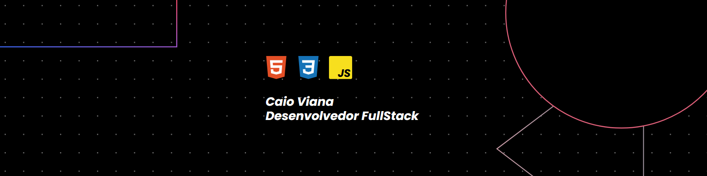

## Olá! 👋 Eu sou o Caio Viana

Desenvolvedor **FullStack** em formação, focado em criar aplicações web modernas. Gosto de transformar ideias em interfaces bonitas e funcionais, e estou sempre estudando para evoluir.

### 🚀 Sobre mim

- 🌱 Atualmente estou estudando: **HTML, CSS e JavaScript**
- 🎯 Estou em busca de uma oportunidade de **estágio**
- 👯 Aberto a colaborar em projetos e aprender com a comunidade
- 📫 Como me encontrar: [LinkedIn](https://www.linkedin.com/in/caio-viana-5540303b7/) | [E-mail](mailto:caioviananog@gmail.com)
- ⚡ Curiosidade: sou apaixonado por tecnologia e adoro aprender coisas novas!

### 🛠️ Linguagens e ferramentas

Obrigado pela visita! Vamos construir algo incrível juntos. 🚀
